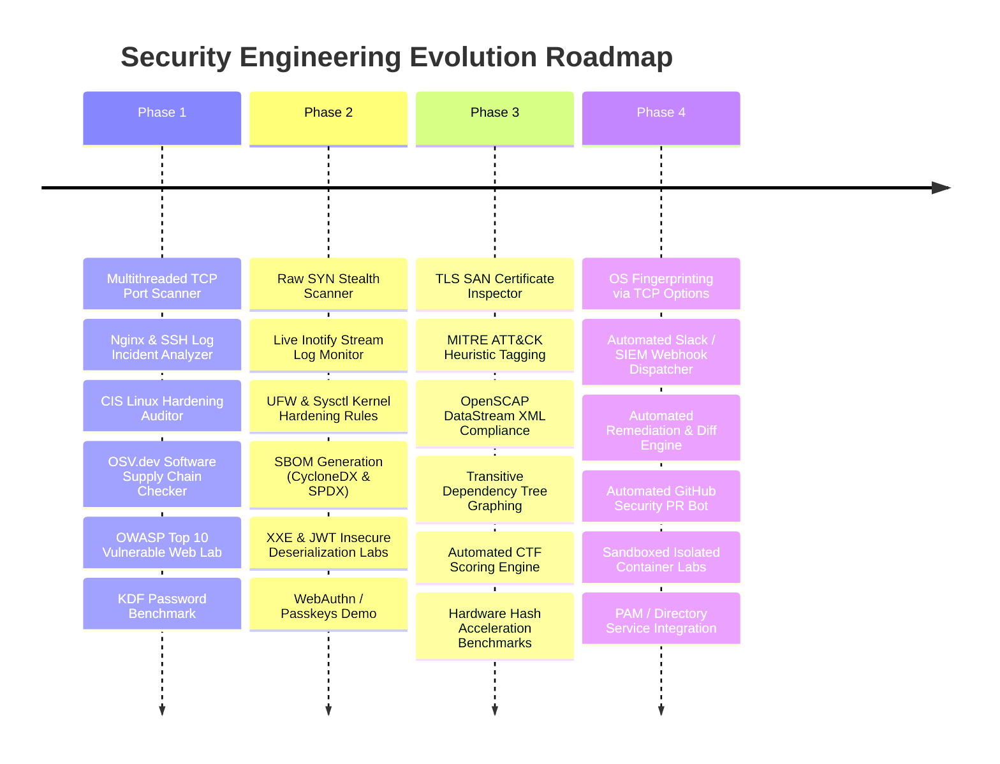

# Security Labs: Application Security & Systems Defense Portfolio

[](https://github.com/ErenYeager1836/security-labs/actions)
[](LICENSE)
[](port-scanner/)
[](pyproject.toml)

A modular monorepo containing six cybersecurity and application security tools built for junior Application Security, Security Operations, and Systems Security Engineering portfolio demonstration.

Each tool represents a distinct domain in defensive cybersecurity, systems programming, and secure software development:

---

## Master Tools Directory

| Tool | Language / Stack | Domain | Capabilities | Tests | Directory |
| :--- | :--- | :--- | :--- | :--- | :--- |
| **`port-scanner`** | C++17, Winsock2 / POSIX Sockets, CMake | Network Security & Systems | Multithreaded TCP connect scanner, non-blocking sockets, banner grabber, worker thread pool, localhost guard | 6/6 C++ Tests | [`port-scanner/`](port-scanner/) |
| **`log-analyzer`** | Python 3, Regex, Standard Library | Blue Team / SIEM & Threat Detection | Parses SSH `auth.log` and Nginx `access.log`, detects brute force attacks, directory scanners (Nikto/sqlmap), traversal/SQLi patterns; generates Markdown incident reports | 11/11 Pytest | [`log-analyzer/`](log-analyzer/) |
| **`hardening-auditor`** | Python 3, Linux Systems Auditing | Systems Hardening & Compliance | Read-only CIS benchmark auditor: inspects SSH daemon config, critical file permissions (`/etc/shadow`, `/etc/sudoers`), listening TCP/UDP sockets, and sudo configuration. Produces posture score (0-100) and actionable remediation commands | 11/11 Pytest | [`hardening-auditor/`](hardening-auditor/) |
| **`dependency-checker`** | Python 3, `urllib`, OSV.dev REST API | Software Supply Chain Security | Scans Python (`requirements.txt`) and Java Maven (`pom.xml`) manifests, queries Google's OSV.dev open vulnerability database in batch, reports CVEs/GHDAs with severity and fixed versions | 7/7 Pytest | [`dependency-checker/`](dependency-checker/) |
| **`vuln-app-lab`** | Python 3, Flask, SQLite3, HTML/CSS | Application Security / OWASP Top 10 | Interactive localhost laboratory demonstrating SQL Injection, Cross-Site Scripting (XSS), Insecure Direct Object References (IDOR), and Server-Side Request Forgery (SSRF) side-by-side in vulnerable vs. cryptographically hardened implementations | 9/9 Pytest | [`vuln-app-lab/`](vuln-app-lab/) |
| **`password-demo`** | Python 3, `bcrypt`, `argon2-cffi`, `hashlib` | Cryptography & Authentication | Educational benchmark comparing MD5 vs. bcrypt vs. Argon2id latency, resistance to offline GPU attacks, and salting defense against rainbow tables | 6/6 Pytest | [`password-demo/`](password-demo/) |

---

## Authorized Use & Security Policy

> [!CAUTION]
> **LEGAL AND ETHICAL DISCLAIMER**
> The tools in this repository are designed strictly for educational, defensive, auditing, and authorized security evaluation purposes.
> 
> 1. **Localhost & Owned Systems Only**: Network active scanners and test suites default to `127.0.0.1` and loopback interfaces. Never point scanning tools at any infrastructure you do not own or lack explicit, prior written authorization to test.
> 2. **Non-Destructive Audits**: All auditor and scanner tools are guaranteed **strictly read-only**; they do not alter configuration files, drop privileges, modify filesystem permissions, or execute system changes.
> 3. **Isolated Vulnerability Testing**: The vulnerable web application (`vuln-app-lab`) binds exclusively to `127.0.0.1` using an ephemeral in-memory SQLite database and should never be exposed to public or untrusted networks.
> 4. **No Hardcoded Secrets**: This repository enforces strict secret-free hygiene across source code, test suites, and sample logs.

---

## Architecture & Monorepo Layout

```text
security-labs/
├── .github/
│   └── workflows/
│       └── ci.yml               # GitHub Actions CI matrix (Ubuntu & Windows C++, Python 3.10-3.12)
├── port-scanner/                # C++17 Multithreaded TCP Port Scanner & Banner Grabber
│   ├── CMakeLists.txt
│   ├── include/
│   │   ├── banner_grabber.hpp
│   │   ├── thread_pool.hpp
│   │   └── utils.hpp
│   ├── src/
│   │   ├── banner_grabber.cpp
│   │   ├── main.cpp
│   │   ├── thread_pool.cpp
│   │   └── utils.cpp
│   ├── tests/
│   │   └── test_scanner.cpp     # C++ socket test harness (6 test cases)
│   └── README.md
├── log-analyzer/                # Python Log Incident Analyzer & Markdown Reporter
│   ├── log_analyzer/
│   │   ├── analyzer.py          # Threat heuristics (brute force, scanner UAs, traversal, SQLi)
│   │   ├── models.py            # Dataclasses for entries and incidents
│   │   ├── parser.py            # Regex parsers for auth.log and nginx access.log
│   │   └── reporter.py          # Markdown incident report generator
│   ├── sample_logs/             # Authentic synthetic sample logs
│   │   ├── auth.log
│   │   └── access.log
│   ├── tests/
│   │   └── test_analyzer.py     # 11 unit & integration tests
│   └── README.md
├── hardening-auditor/           # Read-Only CIS Linux Baseline Compliance Checker
│   ├── hardening_auditor/
│   │   ├── auditor.py           # Core orchestrator and 0-100 score calculator
│   │   ├── checks/              # Rules for SSH, file perms, ports, sudoers
│   │   │   ├── file_permissions.py
│   │   │   ├── open_ports.py
│   │   │   ├── ssh_config.py
│   │   │   └── sudo_config.py
│   │   ├── models.py
│   │   └── reporter.py          # Terminal & Markdown report generator
│   ├── tests/
│   │   └── test_auditor.py      # 11 mock & unit tests (verifies read-only invariant)
│   └── README.md
├── dependency-checker/          # Software Supply Chain OSV.dev Vulnerability Checker
│   ├── dependency_checker/
│   │   ├── cli.py               # CLI entrypoint with exit codes for CI/CD gates
│   │   ├── models.py
│   │   ├── osv.py               # OSV.dev batch REST API client
│   │   ├── parsers/             # requirements.txt and pom.xml parsers
│   │   └── reporter.py          # Terminal tables and Markdown reports
│   ├── sample_files/            # Sample manifests with known CVEs for verification
│   │   ├── requirements.txt
│   │   └── pom.xml
│   ├── tests/
│   │   ├── test_cli.py
│   │   ├── test_osv.py
│   │   └── test_parsers.py      # 7 unit tests
│   └── README.md
├── vuln-app-lab/                # OWASP Top 10 Educational Flask Lab
│   ├── app.py                   # Localhost-only Flask app (SQLi, XSS, IDOR, SSRF)
│   ├── db.py                    # Ephemeral SQLite in-memory database
│   ├── labs/                    # Vulnerable and cryptographically fixed implementations
│   │   ├── idor.py
│   │   ├── sqli.py
│   │   ├── ssrf.py
│   │   └── xss.py
│   ├── templates/index.html     # Interactive exploitation and fix workbench
│   ├── tests/
│   │   └── test_labs.py         # 9 security exploit & defense verification tests
│   └── README.md
├── password-demo/               # Cryptographic Hash Algorithm Benchmark & Salting Demo
│   ├── password_demo/
│   │   ├── benchmark.py         # Latency, memory-cost, and throughput benchmark
│   │   ├── hasher.py            # MD5 vs. bcrypt vs. Argon2id implementations
│   │   └── salting.py           # Rainbow table precomputation resistance demo
│   ├── tests/
│   │   └── test_password_demo.py# 6 unit and benchmark tests
│   └── README.md
├── pyproject.toml               # Unified pytest test discovery and Python path config
├── LICENSE                      # MIT License
└── .gitignore                   # Monorepo build and bytecode ignore rules
```

---

## Getting Started

### Prerequisites

- **C++ Compiler**: GCC 9+, Clang 10+, or MSVC 2019+ supporting **C++17** and **CMake 3.16+**.
- **Python**: **Python 3.10+** (Python 3.11, 3.12, 3.15 tested).
- **Python Virtual Environment**:
  ```bash
  python -m venv .venv
  # On Linux/macOS:
  source .venv/bin/activate
  # On Windows PowerShell:
  .venv\Scripts\Activate.ps1
  ```

### Install Python Dependencies & Package Tools

```bash
pip install --upgrade pip
pip install -r requirements-dev.txt
pip install -e .
```
*(Running `pip install -e .` installs all Python tools and creates CLI commands `log-analyzer`, `hardening-auditor`, `dependency-checker`, and `password-demo` in your virtualenv).*

---

## Running the Test Suites

The monorepo contains **56 automated tests** (6 C++ tests + 50 Python tests) covering functional correctness, security controls, and edge cases.

### Run All 50 Python Tests Across the Monorepo

From the repository root:
```bash
python -m pytest -v
```

Output:
```text
============================== 50 passed in 0.62s ==============================
```

### Run Python Code Style & Linting

```bash
flake8 log-analyzer hardening-auditor dependency-checker vuln-app-lab password-demo \
  --count --select=E9,F63,F7,F82 --show-source --statistics
```

### Build & Run the C++ `port-scanner` Tests

#### On Windows (PowerShell / CMake / MSVC or Ninja):
```powershell
cd port-scanner
cmake -B build -S .
cmake --build build --config Release
.\build\port_scanner_tests.exe
```

#### On Linux / macOS:
```bash
cd port-scanner
cmake -B build -S .
cmake --build build
ctest --test-dir build --output-on-failure
```

---

## Tool-by-Tool Usage Guide

### 1. `port-scanner` (C++17)
Multithreaded TCP port scanner with cross-platform socket abstraction (Winsock2 / POSIX), custom worker thread pool, and HTTP/SSH banner grabber.

```bash
# Build and scan localhost ports 20 through 90 with 50 threads and 500ms timeout
./port-scanner/build/port_scanner -h 127.0.0.1 -p 20-90 -n 50 -t 500
```
*Sample Output:*
```text
=========================================================
       security-labs // port-scanner (C++17)             
  Multithreaded TCP Connect Scanner & Banner Grabber     
=========================================================

[*] Target Host:     127.0.0.1
[*] Port Range:      20 -> 90
[*] Connect Timeout: 500 ms
[*] Worker Threads:  50
[*] Banner Grab:     Enabled

[*] Starting port scan...
[+] Progress: 71/71 ports (100%) 

--- Scan Results ---
No open TCP ports discovered in specified range.

[+] Finished in 0.02s. 0 open port(s) found across 71 ports scanned.
```

### 2. `log-analyzer` (Python)
Audits authentication logs and web server access logs to surface brute force attacks, reconnaissance scanners, and web payloads.

```bash
python log-analyzer/log_analyzer/cli.py \
  --auth-log log-analyzer/sample_logs/auth.log \
  --nginx-log log-analyzer/sample_logs/access.log \
  -o incident_report.md
```
*Generates an actionable markdown report summarizing top offending IP addresses, targeted accounts, scanner user-agents, and matched signatures.*

### 3. `hardening-auditor` (Python)
Non-destructive Linux system hardening configuration auditor aligned with **CIS Linux Benchmark** recommendations (Sections 2.1, 5.2, 5.3, and 6.1). Emits numerical compliance scores and exact shell remediation fixes.

```bash
# Run audit against host or target directory (commands available after pip install -e .)
hardening-auditor -o audit_results.md
# Or via Python module directly:
python -m hardening_auditor.cli -o audit_results.md
```
*Sample Output (Unprivileged Live System Audit on `/`):*
```text
================================================================
      security-labs // hardening-auditor (Python)       
      CIS-Style Read-Only Linux Security Auditor        
================================================================
[*] Target Directory Root : /
[*] Total Controls Audited: 16
[+] Passed Controls       : 12
[-] Failed Controls       : 3
[?] Could Not Check       : 1
[*] Compliance Score      : 75.0%
----------------------------------------------------------------
```
> [!NOTE]
> **Total Controls Audited (19 vs. 16 Explained)**:
> - **19 checks**: When auditing a target filesystem where `/etc/sudoers` is readable (e.g., `sample_configs/unhardened` or when running with root privileges on `/`): 6 SSH checks + 5 File permission checks + 4 Port checks + 4 Sudoers checks (`CIS-SUDO-01` through `04`).
> - **16 checks**: When running without root privileges on live `/`: `/etc/sudoers` has mode 0440 (readable only by root). The auditor cannot read the file, so it reports a distinct `could not check` status for `CIS-SUDO-00` and does not run the 4 privileged sub-checks (6 + 5 + 4 + 1 = 16 controls). A status of `could not check` does **not** count as a pass in the compliance score.

### 4. `dependency-checker` (Python)
Software supply chain security scanner evaluating Python `requirements.txt` and Java `pom.xml` against Google's OSV.dev open vulnerability database.

```bash
# Scan vulnerable sample Python manifest
dependency-checker dependency-checker/sample_files/requirements.txt
```
*Identifies known CVEs, CVSS ratings, advisory links, and safe upgrade targets. Returns exit code 1 on vulnerabilities to gate CI/CD pipelines.*

### 5. `vuln-app-lab` (Flask)
A deliberate localhost application security sandbox demonstrating OWASP Top 10 vulnerabilities in `/vulnerable` vs. `/fixed` routes.

```bash
python vuln-app-lab/app.py
```
*Navigate to `http://127.0.0.1:5000` to interactively compare:*
- **SQLi**: String-concatenated queries vs. parameterized SQL.
- **XSS**: Unescaped reflection vs. HTML escaping and Content Security Policy (CSP).
- **IDOR**: Direct numeric ID lookups vs. session ownership authentication checks.
- **SSRF**: Unvalidated webhook requests vs. private IP/loopback filtering and domain allowlisting.

### 6. `password-demo` (Python)
An educational cryptographic demonstration illustrating why legacy hashes like MD5 are vulnerable to offline attacks, how bcrypt and Argon2id provide tuneable work factors, and how cryptographic salts defeat rainbow tables.

```bash
password-demo --benchmark -i 3
# Or via Python module directly:
python -m password_demo.cli --benchmark -i 3
```

> [!WARNING]
> **Measurement Environment vs. Real-World Attacker Speeds**:
> Timings and hash rates below are measured in single-threaded Python on this host CPU to demonstrate defensive authentication latency. They do **not** represent attacker cracking speeds. On dedicated GPU rigs (e.g. Hashcat on multi-RTX 4090 clusters), attackers achieve **billions of MD5 hashes per second** and orders of magnitude higher throughput against poorly salted or un-hardened hashes.

*Sample Benchmark:*
```text
================================================================================
      PASSWORD HASHING BENCHMARK: MD5 vs bcrypt vs Argon2id      
================================================================================
Algorithm                                    Mean Latency     Hashes/Sec     Slowdown
--------------------------------------------------------------------------------
MD5 (broken general-purpose digest)          0.002 ms         435597.0/s     1.0x baseline
bcrypt (cost=10, 2^10 = 1,024 iterations)    172.253 ms       5.8/s          86126.5x slower
bcrypt (cost=12, 2^12 = 4,096 iterations)    677.866 ms       1.5/s          338933.0x slower
Argon2id (t=3, m=64MB, p=4 - RFC 9106)       130.307 ms       7.7/s          65153.5x slower
--------------------------------------------------------------------------------
```

---

## Continuous Integration

Every commit and pull request runs automated validation in GitHub Actions ([`.github/workflows/ci.yml`](.github/workflows/ci.yml)):
- **C++ Build & Tests**: Matrix tested across `ubuntu-latest` and `windows-latest` using CMake, MSVC, and GCC.
- **Python Tests**: Matrix tested across Python `3.10`, `3.11`, and `3.12`.
- **Linting & Quality**: Flake8 AST and syntax verification across all Python packages.

---

## Limitations

While each tool is engineered for defensive security, auditing, and systems analysis, several deliberate design constraints and technical limitations apply:

- **`port-scanner`**:
  - Uses standard TCP connect scanning (`connect()`), completing the full 3-way handshake. Does not implement raw SYN stealth scanning or UDP ICMP probing, which require elevated privileges (`CAP_NET_RAW` / root).
  - Hardcoded safety guard restricts active scanning targets to `127.0.0.1` and loopback interfaces.
  - Banner grabber uses plaintext HTTP/SSH probes and does not negotiate full TLS/SSL handshakes.
- **`log-analyzer`**:
  - Performs batch analysis on static log files; does not operate as a background daemon or stream live systemd `journald` / syslog events via inotify.
  - Threat detection relies on deterministic regex heuristics, which can be bypassed by polymorphic encoding or novel attack techniques.
- **`hardening-auditor`**:
  - Tailored to standard Linux server distributions; does not evaluate Windows or macOS security baselines.
  - Strictly read-only; it reports discrepancies and suggests shell remediation commands but does not mutate system configuration files.
  - Inspects standard paths (e.g., `/etc/ssh/sshd_config`, `/etc/shadow`); unprivileged executions skip files with restricted read permissions.
- **`dependency-checker`**:
  - Parses direct manifest entries (`requirements.txt`, `pom.xml`); does not resolve complete transitive dependency trees from multi-tier lockfiles (`poetry.lock`, `Pipfile.lock`, `Cargo.lock`).
  - Requires outbound HTTPS network connectivity to Google's OSV.dev REST API for vulnerability resolution.
- **`vuln-app-lab`**:
  - Intended solely as a localhost educational sandbox running on Flask's single-process development server with an ephemeral SQLite database.
  - Intentionally vulnerable by design; must never be deployed on public, shared, or production infrastructure.
- **`password-demo`**:
  - Measures single-threaded CPU hashing latency on the local host; does not benchmark distributed or hardware-accelerated (GPU / ASIC / FPGA) cracking clusters.
  - Benchmarks MD5, bcrypt, and Argon2id; does not evaluate PBKDF2 or scrypt.

---

## Defensive Engineering Roadmap

Each tool in this monorepo is engineered as a clean, working defensive tool. Below is the multi-phase evolution roadmap:



### Detailed Tool Roadmap

#### 1. `port-scanner`
- [x] Multithreaded TCP connect scanning engine with configurable timeout and worker pool.
- [x] Application-layer banner grabbing (HTTP, SSH, FTP, SMTP, MySQL).
- [x] SocketGuard RAII socket cleanup abstraction preventing file descriptor leaks.
- [x] Strict safety guard enforcement restricting active scans to `127.0.0.1` and loopback interfaces.
- [x] **Structured Output**: Export results directly to JSON and CSV for automated vulnerability management ingestion.
- [ ] **Raw SYN Stealth Scanning**: Raw socket TCP SYN scanning (`SOCK_RAW`) on Linux with `CAP_NET_RAW` capability to detect open ports without completing the three-way handshake.
- [ ] **UDP Service Scanning**: Support UDP port probing via ICMP port-unreachable error frame parsing (`SOCK_RAW` / `IPPROTO_ICMP`).
- [ ] **TLS Certificate Inspection**: Automatic TLS negotiation on port 443/8443 to extract certificate Subject Alternative Names (SAN), issuer CA, and expiration dates.
- [ ] **OS Fingerprinting**: Heuristic operating system detection based on initial TCP Window Size, IP TTL defaults, and TCP options order.

#### 2. `log-analyzer`
- [x] Regex parsing for SSH `auth.log` and Nginx `access.log`.
- [x] Threat heuristics: SSH brute-force, web scanner user-agents (Nikto, sqlmap, gobuster), path traversal, SQL injection probes.
- [x] Severity scoring (LOW, MEDIUM, HIGH, CRITICAL) and actionable Markdown incident reporting.
- [x] **Real-Time Streaming Analysis & Live Threat Alerting**: Inspect incoming HTTP event streams for live exploit and scanner detection.
- [x] **MITRE ATT&CK Mapping**: Automatic categorization of detected incident signatures to ATT&CK tactics and techniques (T1110.001 Brute Force, T1190 Exploit Public-Facing Application, T1595.002 Active Scanning, T1083 Discovery).
- [ ] **SIEM / Webhook Dispatcher**: Real-time incident forwarding to Slack, Discord, Microsoft Teams, or Elastic Common Schema (ECS) endpoints.
- [ ] **GeoIP Enrichment**: Integrated MaxMind GeoLite2 lookup for geolocation tracking of external attack sources.

#### 3. `hardening-auditor`
- [x] Read-only CIS baseline audits across SSH daemon configuration, critical file permissions, open listening sockets, and sudo privileges.
- [x] Hardening posture score calculation (0-100) and actionable remediation commands.
- [x] Guaranteed zero-risk read-only safety invariant.
- [x] **Automated Remediation Engine**: Non-destructive remediation plan generator with pre-flight backup targets and dry-run unified diff previews.
- [ ] **Firewall & Kernel Rules**: Auditing UFW/iptables default deny policies, IP forwarding status (`net.ipv4.ip_forward=0`), and ASLR kernel parameter configuration.
- [ ] **OpenSCAP / SCAP Compliance**: Exporting audit results to standard SCAP DataStream XML for integration into enterprise compliance reporting tools.

#### 4. `dependency-checker`
- [x] Manifest parsing for Python (`requirements.txt`) and Java Maven (`pom.xml`).
- [x] Google OSV.dev batch REST API client for fast $O(1)$ batch vulnerability resolution.
- [x] Severity threshold filtering (LOW, MEDIUM, HIGH, CRITICAL) and CI/CD non-zero exit codes.
- [x] **SBOM Generation**: Exporting compliant Software Bill of Materials in CycloneDX 1.5 JSON with Package URL (purl) specifications.
- [ ] **Extended Lockfile Support**: Parsing lockfiles including `package-lock.json` (npm), `poetry.lock` / `Pipfile.lock` (Python), and `Cargo.lock` (Rust).
- [ ] **Transitive Dependency Tree**: Dependency graph traversal to identify deep vulnerabilities introduced by indirect child dependencies.
- [ ] **Automated Remediation PRs**: Generating automated dependency upgrade suggestions based on OSV fixed-version metadata.

#### 5. `vuln-app-lab`
- [x] Interactive localhost web workbench comparing vulnerable vs. cryptographically secured code for SQLi, XSS, IDOR, and SSRF.
- [x] In-memory SQLite database isolation with zero persistent footprint.
- [x] Automated test suite verifying exploit effectiveness and defense integrity.
- [ ] **Extended OWASP Vulnerability Modules**: Additional interactive labs for Insecure Deserialization (Python `pickle`), XML External Entity (XXE), and Broken Authentication / JWT signature bypass.
- [ ] **CTF Challenge Mode**: Gamified CTF platform with capture-the-flag validation tokens and progress tracking.
- [ ] **Containerized Deployment**: Multi-stage rootless Docker containerization for instant, safe sandbox testing on any host.

#### 6. `password-demo`
- [x] Performance and throughput benchmarking comparing MD5, bcrypt, and Argon2id.
- [x] Work factor tuning demonstration showing the defensive effect of bcrypt cost and Argon2id time/memory parameters.
- [x] Salting defense demonstration against precomputed rainbow table dictionaries.
- [ ] **Extended KDF Implementations**: Adding PBKDF2 (NIST SP 800-132) and scrypt to benchmark comparisons.
- [ ] **Password Strength Entropy Calculator**: Implementation of the zxcvbn algorithmic model to calculate real-world entropy and crack time estimates.
- [ ] **Modern WebAuthn / Passkeys Demo**: Educational demonstration of FIDO2 public-key cryptography replacing shared secrets with cryptographic challenge-response authentication.

---

## License

This project is licensed under the MIT License - see the [LICENSE](LICENSE) file for details.
